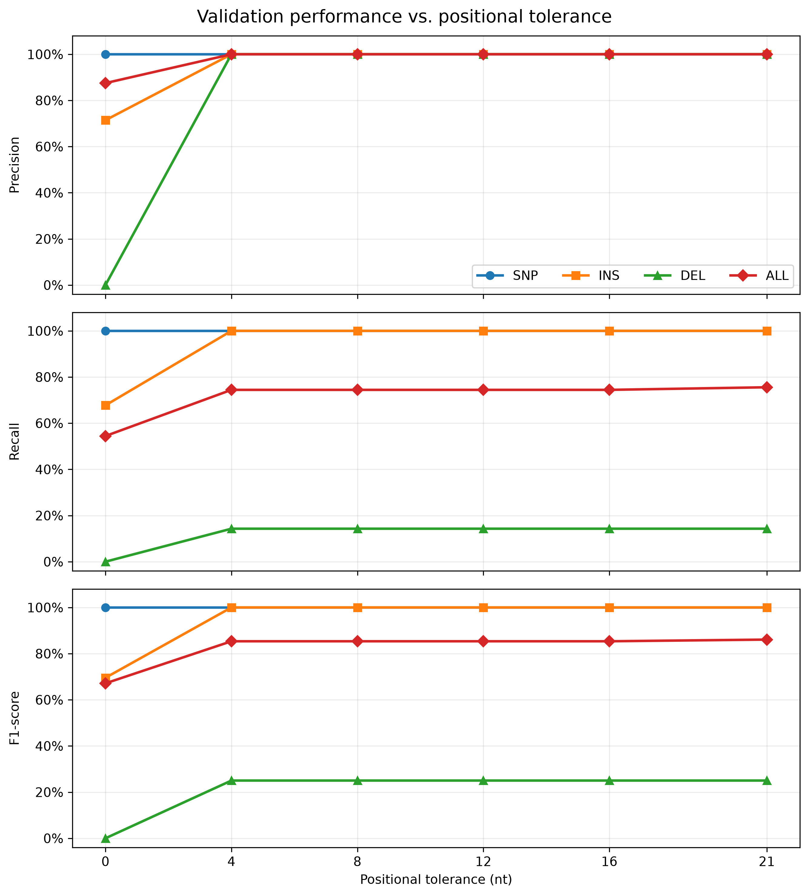
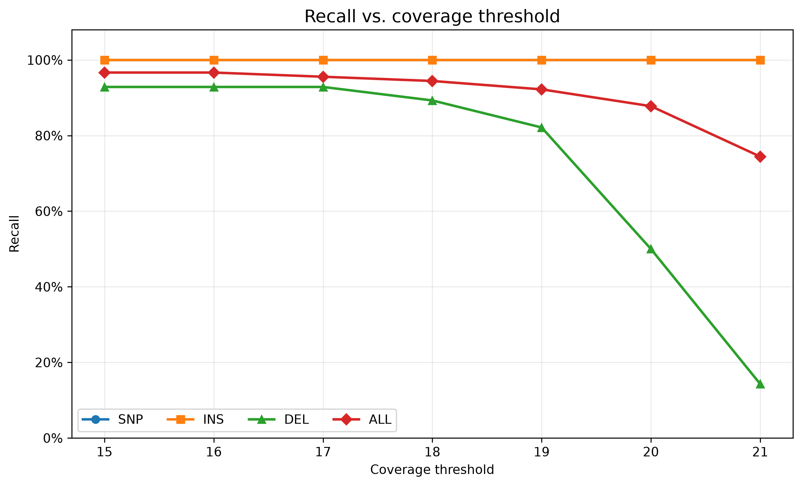

# Rare Sequence Finder

Rare Sequence Finder is a C++17 command-line tool that uses an **alignment-free k-mer approach** to locate candidate regions in DNA sequences containing k-mers that are absent from, or uncommon among the reference collection.

**Only reference and target FASTA files are needed for detection.** Simulation is optional and is used for validation.


## Features

- Encoded DNA k-mer analysis with configurable `k` (`1–31`).
- Reference k-mer tracking across an arbitrary number of reference sequences.
- Adjustable reference-frequency and rare k-mer coverage thresholds.
- Multi-record reference and target FASTA support.
- Candidate coordinates and sequences in TXT/TSV reports, with JSON metadata.
- Optional simulation-based validation for SNPs, insertions, deletions, and mixed mutations.


## Requirements

**Core detector (Linux or WSL):** GNU Make, CMake 3.20+, and a C++17-compatible compiler.

**Optional validation:** Python 3.12 with `venv` and `pip`. Mutation-Simulator and the analysis dependencies are installed through the Makefile. Python is not needed for normal detection.


## Quick Start

Run the included demo (automatically builds the detector):

```bash
make demo
```

Demo results are saved as `result/demo_result.txt`, `result/demo_result.tsv`, and `result/demo_metadata.json`.

Run detection using the default inputs (`data/ref/ref.fasta` and the first `data/MS_output/*_ms.fasta`):

```bash
make run
```

Both default input files must exist. To use your own FASTA files instead:

```bash
make run -- -r path/to/reference.fasta -m path/to/target.fasta
```

Results are saved as `result/result.txt`, `result/result.tsv`, and `result/metadata.json`. Your target FASTA does **not** need to come from a simulator.


## Usage

| Option | Description | Default |
| --- | --- | --- |
| `-r`, `--reference` | Reference FASTA file | `data/ref/ref.fasta` |
| `-m`, `--mutant` | Target FASTA file | `data/MS_output/*_ms.fasta` |
| `-k`, `--kmer-size` | K-mer size (`1–31`) | `21` |
| `-mrf`, `--max-ref-freq` | Maximum reference frequency (`0 ≤ value < 1`) | `0` |
| `-ct`, `--coverage` | Minimum rare k-mer coverage (`1–k`) | `k` |

*These file-path defaults are supplied by `make run` when the files exist. Both FASTA inputs are required by the detector itself.*

Example with custom parameters:

```bash
make run -- -r reference.fasta -m target.fasta -k 21 -ct 18 -mrf 0
```

Input files may use `.fa`, `.fasta`, `.fna`, or `.fas` extensions. Detection outputs are overwritten by subsequent `make run` commands.


## Make Commands

| Command | Description |
| --- | --- |
| `make demo` | Build and run the included example. |
| `make build` | Compile the C++ detector. |
| `make run` | Build and run detection (with optional CLI arguments). |
| `make clean` | Remove build files and the Python virtual environment. |
| `make ms_setup` | Install Mutation-Simulator (optional). |
| `make generate_test_data` | Generate simulated sequences and ground truth (optional). |
| `make analyze_setup` | Install validation dependencies (optional). |
| `make analyze` | Evaluate detection results against ground truth (optional). |

## Optional: Validation

The built-in validation workflow compares detected regions with mutations generated by [Mutation-Simulator](https://github.com/mkpython3/Mutation-Simulator). To use the default paths, place a reference FASTA at `data/ref/ref.fasta` and run:

```bash
make generate_test_data  # Generate simulated FASTA and VCF
make run                 # Detect candidate regions
make analyze             # Calculate validation metrics
```

`make generate_test_data` and `make analyze` automatically set up their Python dependencies. The summaries are saved in `analysis/summary/` as `*_validation.tsv` and `*_multimatch.tsv`.

Both steps accept optional CLI arguments via Make:

```bash
make generate_test_data -- --ref path/to/reference.fasta --s specific seed
make analyze -- --res path/to/result.tsv --gt path/to/truth.vcf --md path/to/metadata.json
```

The first command changes the reference used for sequence selection; when doing so, use the same reference with `make run -- -r ...`. The second command overrides the result, ground-truth VCF, and metadata paths. Without these arguments, the scripts use their default paths.

Furthermore, [RMT configuration](config/mutation.rmt) details can be found in the [Mutation Simulator README](https://github.com/mkpython3/Mutation-Simulator#rmt-mode).

## Validation Result

Results below measure **candidate-region matching** against simulated mutations, using a positional tolerance in nucleotides.

The positional tolerance length is calculated as:

`positional tolerance = floor(k-mer length × tolerance rate)`.

For k = 21 and a tolerance rate of 0.2, the positional tolerance is floor(21 × 0.2) = 4 nt.

### Tobacco mosaic virus (`HE818460.1`)

The [original target sequence](data/validation_result/HE818460.1/unmutated_seq/HE818460.1_with_tag.fasta) was mutated with SNP, insertion (INS), deletion (DEL), and mixed (ALL) mutation profiles. The resulting [mutated sequences](data/validation_result/HE818460.1/mutated_seq/mutated_HE818460.1.fasta) were evaluated against 20 [reference sequences](data/validation_result/HE818460.1/reference/reference.fasta) (`k=21`, `-mrf 0`).

**Detection accuracy** ([`-ct 21`](data/validation_result/HE818460.1/validation_table/HE818460.1_validation_21.tsv), positional tolerance = 0 , 4 nt):

| Profile | positional tolerance | Precision | Recall | F1-score |
| --- | ---: | ---: | ---: | ---: |
| SNP | 0 | 1.0000 | 1.0000 | 1.0000 |
| INS | 0 | 0.7143 | 0.6774 | 0.6954 |
| DEL | 0 | 0.0000 | 0.0000 | 0.0000 |
| ALL | 0 | 0.8750 | 0.5444 | 0.6712 |
| SNP | 4 | 1.0000 | 1.0000 | 1.0000 |
| INS | 4 | 1.0000 | 1.0000 | 1.0000 |
| DEL | 4 | 1.0000 | 0.1429 | 0.2501 |
| ALL | 4 | 1.0000 | 0.7444 | 0.8535 |

**Positional tolerance** (`-ct 21`):



Increasing tolerance improves matching for some mutation profiles, while deletion recall remains relatively low at this coverage threshold.

**Coverage threshold** (tolerance = 4 nt, [`-ct 15–21`](data/validation_result/HE818460.1/validation_table)):



Lower coverage thresholds improve DEL and ALL recall in this dataset; SNP and INS recall stay at 1.0.
## Project Structure

```text
Rare-Sequence-Finder/
├── Makefile                  # Build, run, and validation commands
├── CMakeLists.txt
├── src/                      # C++ implementation
├── include/                  # C++ headers
├── data/
│   ├── demo/                 # Built-in demo
│   ├── ref/                  # Reference input for default workflow
│   ├── selected/             # Selected simulation input
│   ├── MS_output/            # Simulated FASTA and VCF
│   └──validation_result/     # Validation figures and data
├── config/                   # Simulation configuration
├── scripts/                  # Simulation input preparation
├── analysis/                 # Validation summary
├── build/                    # Build output
└── result/                   # Detector output
```

